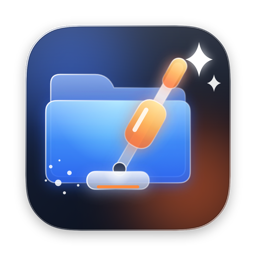
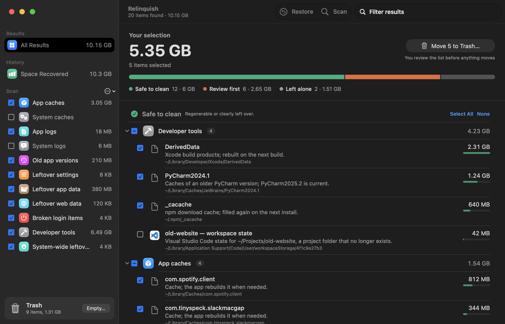
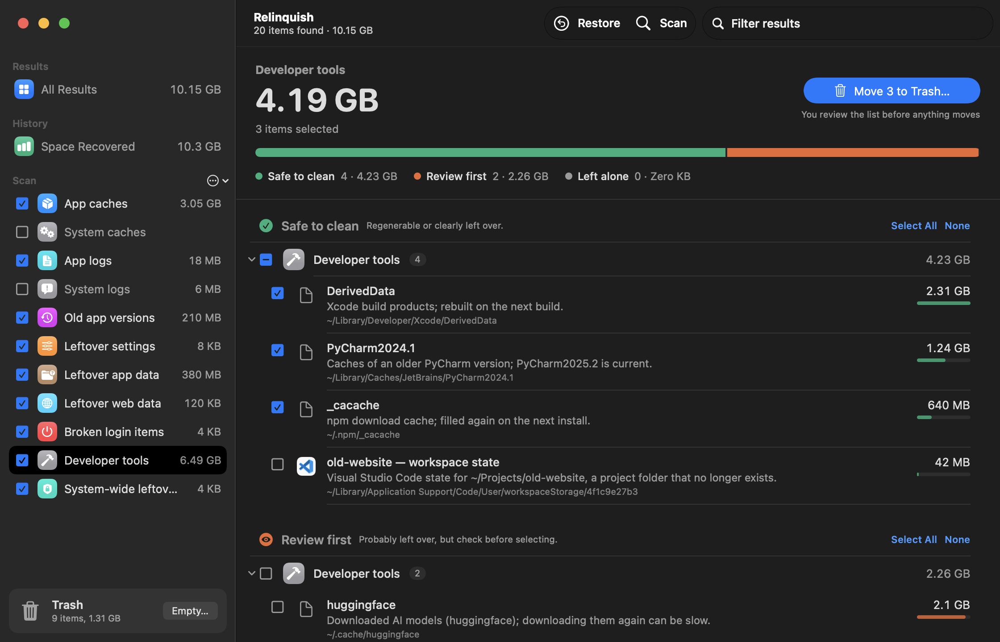
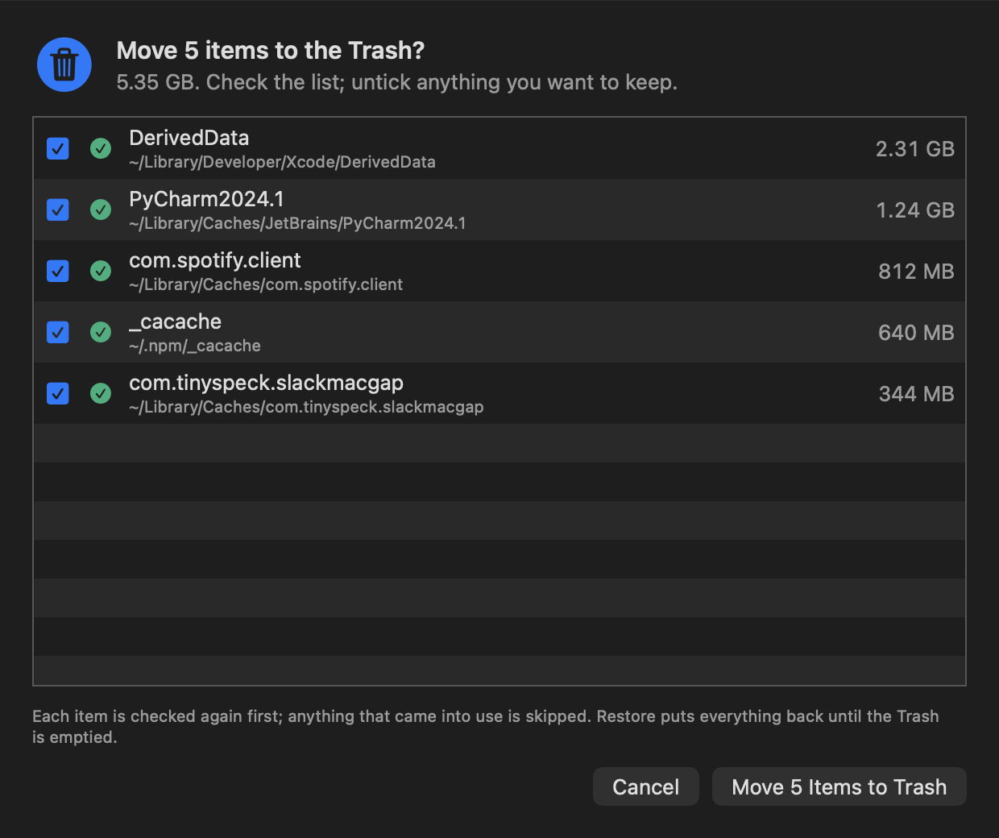
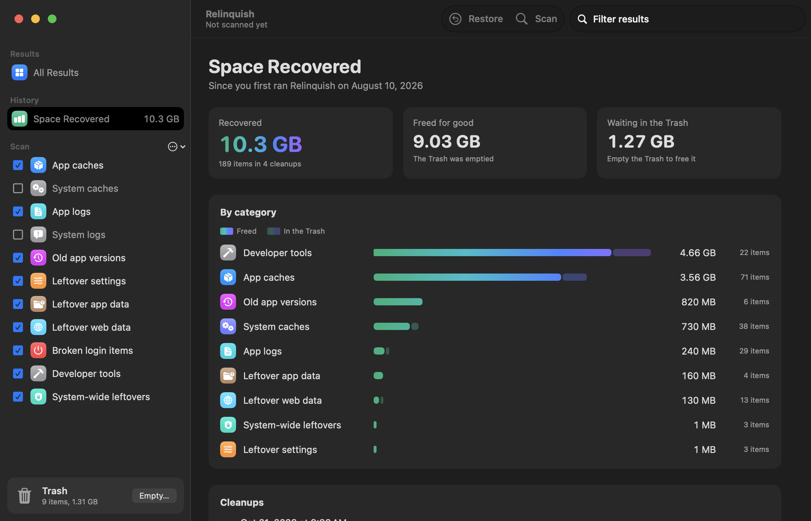

<p align="center">
  
</p>

<h1 align="center">Relinquish</h1>

<p align="center">A Mac cleaner: it finds caches, logs, old app versions, developer leftovers and the traces of apps you removed, explains each find, and moves only what you pick to the Trash.</p>

---

## What it does

- **Finds what your Mac no longer needs:** caches, logs and crash reports, old copies left by app updaters, settings and data of apps you have removed, broken login items, and the leftovers of code editors, IDEs and build tools.
- **Details in every find:** each item says why it showed up, how big it is, and which of three groups it is in: **Safe to clean**, **Review first**, or **Left alone** (in use right now).
- **You pick, always:** nothing is ever selected for you. Before anything moves, a list shows every item you picked, and you can still untick any of them.
- **Undo:** items go to the Trash, not straight to deletion. **Restore** puts the last cleanup back until the Trash is emptied.
- **Secure by design:** macOS files, Mail, Messages, Keychains, iCloud and your projects are never scanned. Anything a running app is using is left alone, and every item is checked again right before it moves.

## What it scans

Select the areas to scan in the sidebar; your choice is saved.

| Area | What it finds |
|---|---|
| App caches | caches of apps, and cache folders inside their data |
| System caches | macOS caches that are rebuilt automatically and not in use |
| App logs | log folders of apps |
| System logs | macOS logs and crash reports |
| Old app versions | older copies an updater left next to the current version |
| Leftover settings | preference files of apps that are no longer installed |
| Leftover app data | data folders no installed app matches (always "Review first") |
| Leftover web data | cookies, web storage and saved windows of removed apps |
| Broken login items | login items that start a program that no longer exists |
| Developer tools | leftovers of code editors and IDEs, and build tool caches (see below) |
| System-wide leftovers | leftovers of removed apps in `/Library`: caches, logs, data, settings, background services and helpers |

### Developer tools

| Tool | What it finds |
|---|---|
| VS Code, VS Code Insiders, VSCodium, Cursor, Windsurf, Antigravity, Trae, Kiro, Void, Positron | workspace state for project folders that no longer exist, code caches of older editor versions, extension versions the editor no longer uses, dictation runtimes |
| JetBrains IDEs, Android Studio | caches, logs and settings left by older IDE versions |
| Xcode | build products (DerivedData), previews, documentation and simulator caches, device symbols, archives |
| Sublime Text, Zed | Sublime's symbol index, tools Zed downloaded |
| Build tools | npm, Gradle, Maven, Cargo, Go, Dart/Flutter, Bun, pnpm, CocoaPods |
| Other | Android emulators and system images, `~/.cache` folders, core dumps |

## Screenshots

<p align="center">
  
</p>

<p align="center">
  
</p>

<p align="center">
  
</p>

<p align="center">
  
</p>

## Requirements

**To run**
- macOS 13 Ventura or later

**To build**
- The Xcode Command Line Tools. The full Xcode app is **not** needed. To install them:

  ```bash
  xcode-select --install
  ```

## Installation

In Terminal, from this folder:

```bash
./build.sh install
```

This builds the app, installs it to the Applications folder in your home folder, and opens it. To only build, run `./build.sh`; the app is then in the `build` folder.

## How to use

1. **Check the areas** you want scanned in the sidebar. Hover an area to see what it covers. The **…** menu ticks all areas or goes back to the recommended ones.
2. **Press Scan** (⌘R). A bar shows the progress.
3. **Look through the results.** Click an area in the sidebar to see only its results, or use **Filter results**. Double-click an item, or use its menu, to show it in Finder.
4. **Tick what you want gone**, item by item or with **Select All** on a group.
5. **Press Move to Trash…**, check the list, and confirm.
6. Changed your mind? Use **Undo** in the banner, or **Restore** in the toolbar.

The **Trash** box at the bottom of the sidebar shows what is in the Trash. **Empty…** deletes it for good after you confirm; after that, earlier cleanups can no longer be restored.

## System-wide leftovers

Items in `/Library` belong to the system, so they show a lock (hover it: *Requires admin privileges*). When you move them, macOS shows its own password dialog once for the whole batch. Relinquish never sees your password, and cancelling the dialog moves nothing.

Each item is checked again with administrator rights right before it moves: it must still exist, no program may have files open inside it, and nothing in the Trash may already have its name. Nothing is ever overwritten. Restore puts these items back the same way.

## Privacy

- Everything happens on your Mac. Relinquish does not connect to the internet, and there is no analytics or tracking.
- It asks Finder to empty the Trash, so macOS asks once whether Relinquish may control Finder.
- Items owned by the system move only after you approve the macOS password dialog.

## Troubleshooting

- **Some folders are skipped ("hidden by macOS privacy protection"):** macOS keeps a few folders private. To include them, add Relinquish in System Settings → Privacy & Security → Full Disk Access. This also lets it show the Trash's size.
- **An item stays under "Left alone":** the app it belongs to is running, or a program has a file open inside it. Quit that app and scan again.
- **Empty… says it may not control Finder:** allow Relinquish in System Settings → Privacy & Security → Automation, or empty the Trash from Finder.
- **Finder asks for a password when emptying the Trash:** system-wide items stay owned by the system while they are in the Trash.
- **Restore says an item is no longer in the Trash:** the Trash was emptied, or the item was moved out of it.

## Uninstall

Quit Relinquish, then move it from the Applications folder in your home folder to the Trash. To also remove its cleanup history and settings, delete `~/Library/Application Support/Relinquish` and `~/Library/Preferences/app.relinquish.Relinquish.plist`.

## Licence

MIT. See [LICENSE](LICENSE).
